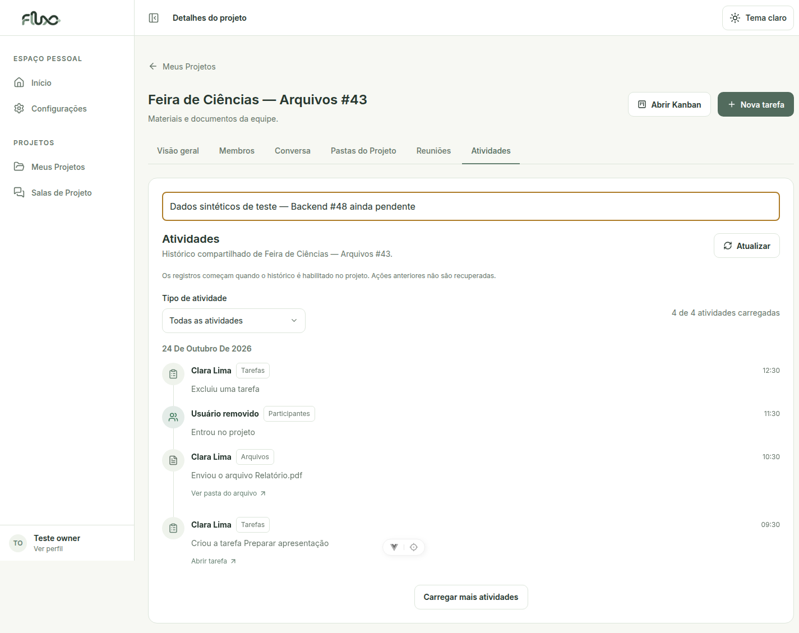
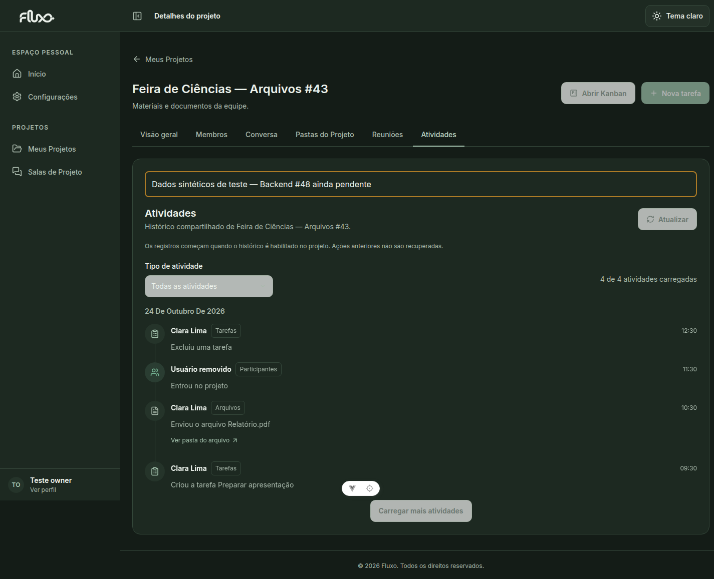
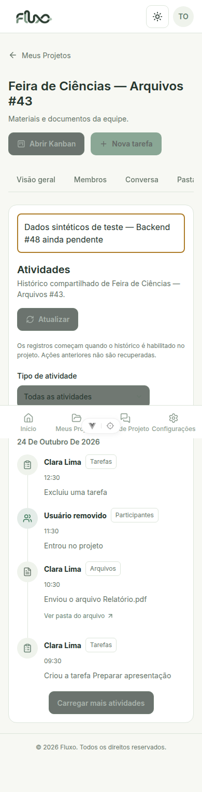
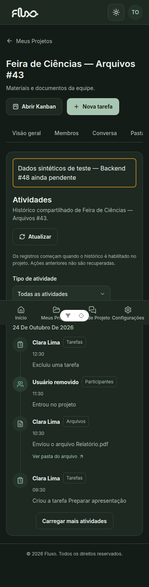

# Registros recentes — #47

A pedido do solicitante, o feed de histórico foi substituído por um resumo dos recursos atuais. A aba **Registros recentes** mantém a URL `/projects/:id?aba=atividades` e não depende da Backend #48.

## Fontes reais e limites

- Tarefas atuais: `GET /tasks/?project={id}` (todas as páginas) e detalhes `/tasks/{id}/` para `created_at`, `created_by` e `created_by_name`, que não constam na lista atual. No máximo quatro consultas de detalhes simultâneas.
- Arquivos atuais, incluindo subpastas: `GET /files/?project={id}`, sem filtro de pasta. Usa `uploaded_at` e autoria reais.
- Participantes atuais: `GET /memberships/?project={id}`. Usa `joined_at` e o próprio participante; não afirma quem o convidou ou adicionou.
- O projeto é validado antes da agregação. Cada fonte é conferida para impedir mistura entre projetos. JWT/refresh e paginação existentes são reutilizados.

A coleção completa é ordenada pelas datas reais, com filtros locais completos e exibição de 20 registros por vez. Não há inferência a partir de `updated_at`, datas fictícias, histórico no localStorage, polling ou WebSocket.

**Não é auditoria nem histórico permanente.** Não mostra edições, movimentações, exclusões ou saídas. Um item removido desaparece depois de atualizar; nomes são os atuais e não snapshots históricos. Tarefas sem data de criação válida são omitidas com aviso. Falha em uma fonte gera aviso de resumo parcial; falha de acesso limpa o resultado. A interface informa esses limites.

Links de tarefas e pastas de arquivos são internos e revalidam recurso/projeto no clique. A timeline interpola texto pelo Vue e não exibe descrições, comentários, e-mails de membros, tokens ou URLs privadas retornados pelos detalhes.

## Validação

Nesta revisão foram executados os testes de atividades e o build. Os scripts de integração abaixo são opt-in e precisam das fixtures locais descritas a seguir.

- `npm run test:activities`: nove testes cobrindo agregação, fontes paginadas, isolamento, detalhes concorrentes, falhas parciais, exclusão concorrente, datas válidas, IDs sem colisão e respostas atrasadas.
- `npm run lint`, `npm run build`, `git diff --check`.
- `node tests/activities/real-api.mjs`: roteiro para backend local real com banco descartável. Confere datas/autoria, arquivos em subpastas, exclusão removendo o item na atualização, edição sem criar novo evento e ausência de chamadas para `/activities/`.
- `node tests/activities/browser.mjs`: roteiro para backend local real, sem interceptação de APIs de atividades. Exercita filtros, mostrar mais, link da tarefa, troca de projeto, F5 e desktop/mobile Light/Dark.

Os testes opt-in usam a conta de teste privada em `/tmp/fluxo43-sessions.json`, backend em :8043 e frontend em :5143 (`FLUXO_TEST_API` e `FLUXO_TEST_FRONTEND` opcionais). O teste de API cria exclusivamente projetos, tarefa e arquivos descartáveis e prepara `/tmp/fluxo47-recent-sessions.json` com permissão 0600. Não executar contra produção.

## Conferir na interface

1. Meus Projetos → Abrir projeto → **Registros recentes**.
2. Conferir o aviso dos limites e alternar Tarefas, Arquivos e Participantes.
3. Criar tarefa, enviar arquivo e atualizar a aba. Conferir datas, autoria e links.
4. Renomear uma tarefa: o registro de criação passa a usar o nome atual; não deve surgir um evento de edição.
5. Excluir arquivo/tarefa ou remover participante e atualizar: o item deixa de fazer parte do resumo.
6. Trocar de projeto, dar F5 e testar mobile/temas.

## Capturas de referência com fixtures

As capturas abaixo foram produzidas com fixtures e servem como referência visual; não comprovam a integração com o backend real.

