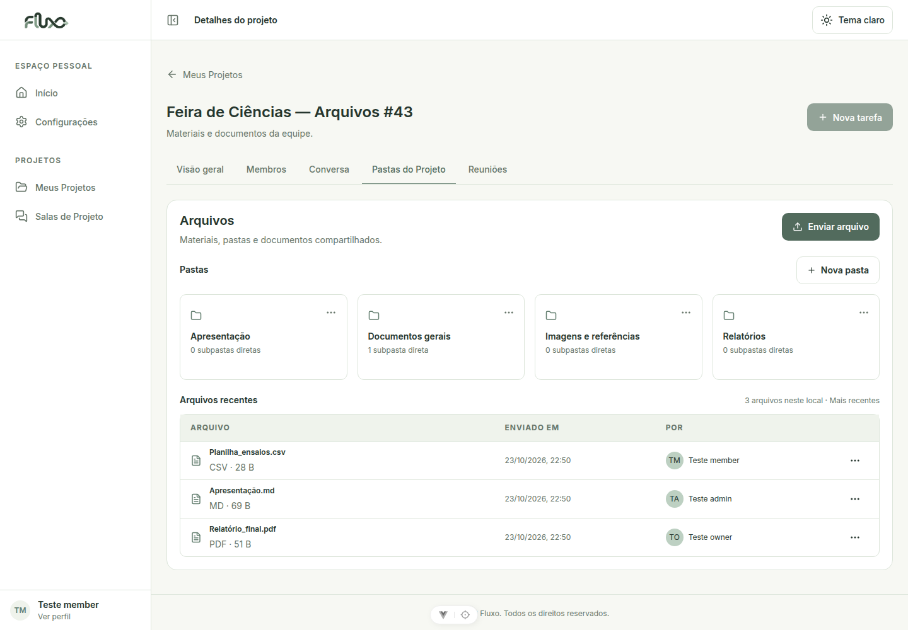
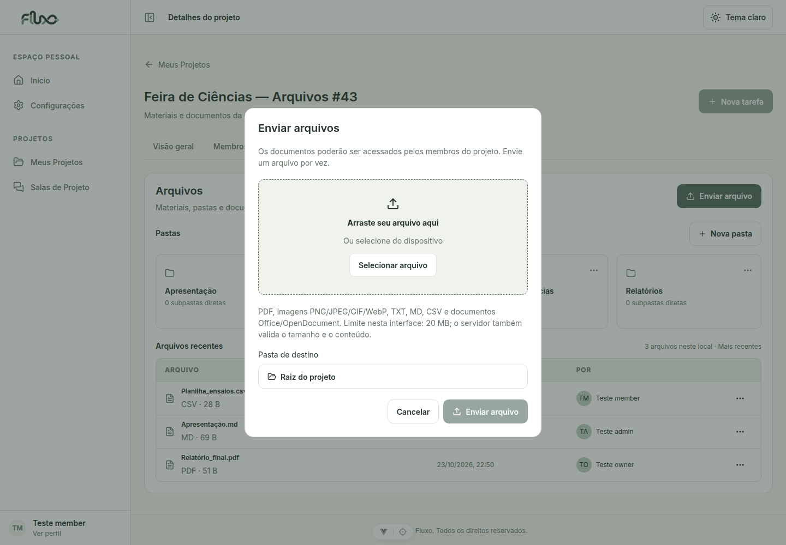
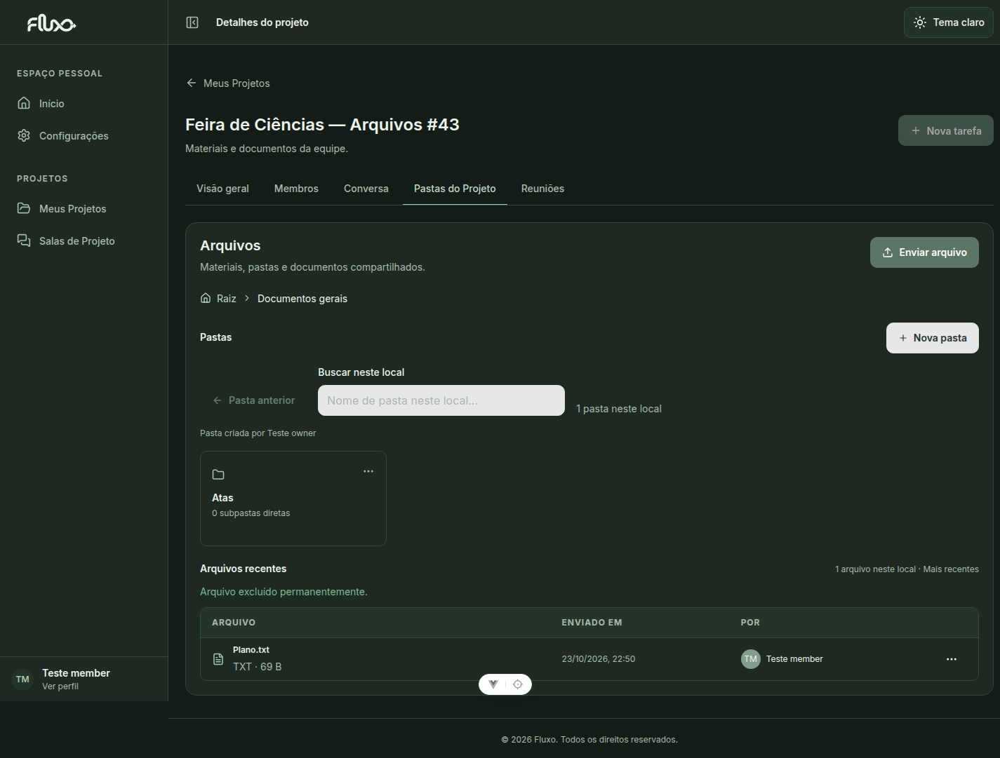
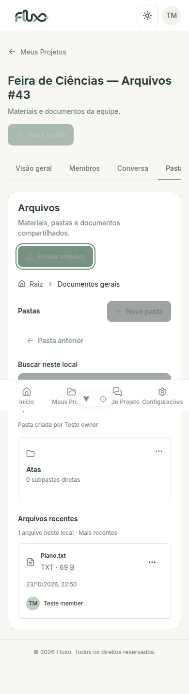
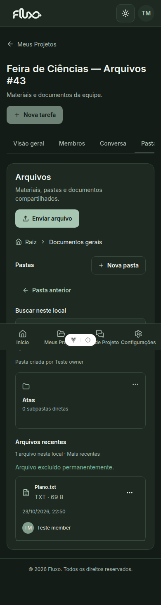
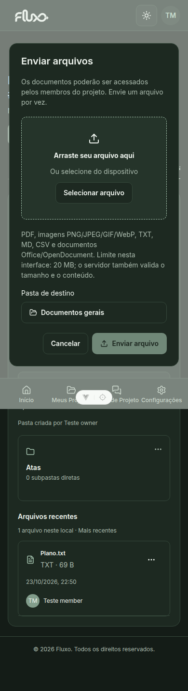

# Arquivos dos projetos — #43

## Comportamento

Em Meus Projetos → Abrir projeto → Pastas do Projeto, a lista de arquivos mostra somente a raiz ou a pasta aberta. Busca todas as páginas e depois ordena pelo upload mais recente. Pastas, breadcrumb, URL/F5 e CRUD existentes da #36 são preservados. A tabela usa o horário real de upload; a API não fornece data de modificação.

Qualquer participante pode enviar, baixar, renomear, mover ou excluir. O envio é de um arquivo por vez, pelo seletor nativo ou arrastando para o modal; a seleção pode ser substituída/removida. O destino pode ser a pasta atual, a raiz ou outra pasta do mesmo projeto. Falhas de validação preservam o modal e a seleção.

Downloads usam o endpoint autenticado com resposta blob, sem links públicos de storage nem preview de conteúdo. O nome de download vem do Content-Disposition quando disponível, com fallback nos metadados. A URL temporária é revogada depois de iniciar o download. Renomear e mover não reenviam o binário.

A interface aceita PDF, PNG/JPG/JPEG/GIF/WebP, TXT/MD/CSV, DOC/DOCX, XLS/XLSX, PPT/PPTX e ODT/ODS/ODP. O limite superficial padrão é 20 MB; `VITE_PROJECT_FILE_MAX_UPLOAD_MB` permite alinhá-lo a `PROJECT_FILE_MAX_UPLOAD_MB` do backend. O servidor decide a aceitação pelo conteúdo e pelo limite configurado. ZIP, HTML, SVG e executáveis não são oferecidos.

## Ambiente e validação realizada

Frontend baseado na dev `4b9cec817f89dca0cd08585136903f4f460fbc3d`. Backend real dev `57905eaabeeac30e64968c7c19208fbcc61cee7a`, extraído em `/tmp/fluxo43-backend`, com todas as migrações aplicadas e SQLite/storage descartáveis em /tmp. O checkout e banco originais do backend foram preservados.

Passaram:

- `npm run test:files` (10 testes de client/estado/renderização): paginação de 105 registros, raiz/subpasta, isolamento, cancelamento, respostas atrasadas, multipart, blob/JSON de erro, metadados de escrita, nomes escapados, validação e limpeza de objectURL.
- Regressões: `test:folders`, `test:projects`, `test:dashboard`, `test:members`, `test:chat`, `test:calls`.
- `npm run lint`, `npm run build` e `git diff --check`.
- Backend real: upload multipart, metadados, listagem, download com conteúdo conferido, rename/move/delete por participantes, bloqueio de usuário externo, sessão ausente, arquivo removido, pasta de outro projeto, vazio, tamanho excedido, extensão proibida, conteúdo incompatível e 105 uploads com paginação completa.
- Chrome com backend real: login, raiz, upload pelo seletor nativo, F5, rename, download salvo com conteúdo comparado, mover para pasta, URL direta/F5 de pasta, excluir com confirmação, desktop/mobile, Light/Dark, Escape e retorno de foco.

## Reproduzir testes de integração

Usar exclusivamente uma cópia do backend com banco/storage descartáveis e migrações aplicadas. Os scripts criam contas, projetos e arquivos de teste; não executar contra produção. Não há mocks no cenário de integração/navegador.

1. Iniciar o backend de teste em `http://127.0.0.1:8043/api/` (ou configurar `FLUXO_TEST_API` para o teste de API).
2. Iniciar o frontend: `VITE_API_URL=http://127.0.0.1:8043/api/ VITE_DASHBOARD_DEMO=false npm run dev -- --host 127.0.0.1 --port 5143`.
3. Executar `node tests/files/real-api.mjs`. Usa o client real do frontend com Axios, cria owner/admin/member/outsider e prepara `/tmp/fluxo43-sessions.json` com permissão 0600 e `/tmp/fluxo43-upload.txt`. Tokens/senhas não são impressos nem versionados.
4. Com Google Chrome instalado, executar `node tests/files/browser.mjs`. Usa a fixture e backend acima. O frontend pode ser alterado com `FLUXO_TEST_FRONTEND`. O cenário limpa apenas arquivos criados por ele na fixture para poder repetir a execução.
5. As capturas ficam em `/tmp/fluxo43-screenshots`; downloads em diretório temporário exclusivo. O cenário compara o conteúdo salvo e não apenas a mensagem visual.

## Roteiro de revisão manual

1. Abrir um projeto como member e entrar em Pastas do Projeto. Conferir nomes, tipo, tamanho, autoria e horário reais.
2. Enviar TXT/PDF na raiz; repetir em subpasta. Trocar a seleção e escolher outro destino pelo modal. Conferir contagem, fechar/reabrir e dar F5.
3. Baixar um arquivo e conferir nome/conteúdo. Renomear, mover para outra pasta e de volta à raiz; conferir que o binário permanece intacto.
4. Excluir com confirmação e conferir desaparecimento após sucesso. Tentar operar um arquivo excluído em outra sessão. Excluir pasta com subpastas/arquivos e conferir o aviso de exclusão permanente.
5. Repetir como owner/admin/member. Usuário externo não deve acessar arquivos do projeto, inclusive por download direto.
6. Testar arquivo vazio, grande, HTML/ZIP/SVG e um TXT renomeado para PDF. A API deve recusar os conteúdos inválidos.
7. Alternar rapidamente pastas/projetos; registros antigos não podem aparecer no local atual. Testar conexão indisponível, repetir a listagem e conferir que um erro não gera sucesso falso.
8. Conferir temas, teclado (Tab/Enter/Escape), foco dos modais e viewport mobile de 390 px sem estouro horizontal.

## Capturas

Todas as telas usam dados reais das contas de teste e componentes/tokens atuais do Fluxo.

## Limites da validação

Testado com backend local real e storage em disco; não foi validado deploy remoto/Cloudinary. O limite de upload não é descoberto automaticamente pela API: alinhar as variáveis frontend/backend no ambiente. Não há contagem fictícia por pasta nem integração de arquivos com tarefas/Kanban nesta entrega. Ações interrompidas por mudança de contexto têm suas respostas ignoradas; uma escrita já recebida pelo servidor pode persistir e será vista ao retornar ao local.
