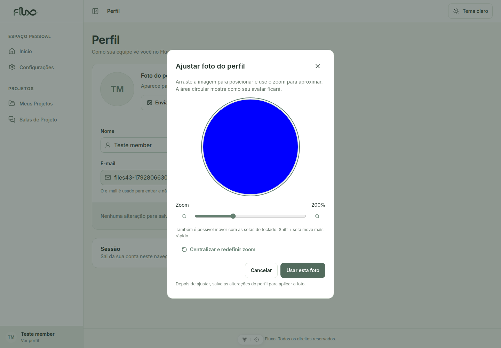
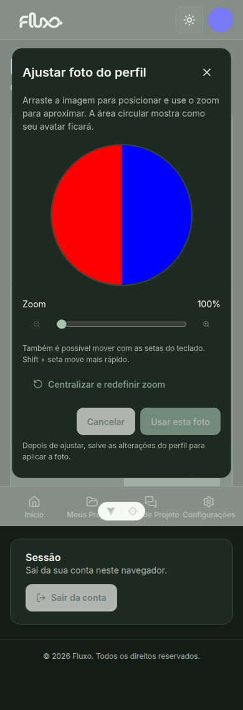

# Enquadramento da foto do perfil

Após selecionar PNG/JPG, o editor permite zoom entre 1× e 4×, arraste com mouse/toque, movimento pelas setas e reset do enquadramento. A prévia circular e o arquivo exportado usam a mesma área da imagem. O recorte quadrado é exportado em PNG/JPEG, com até 512 px; o uploader e a persistência do perfil existentes são reutilizados.

Usar esta foto atualiza a prévia local. Salvar alterações envia o arquivo. Ajustar foto permite reabrir o recorte da imagem original enquanto ele estiver pendente; cancelar mantém a seleção anterior. Após salvar/F5, uma nova edição requer selecionar a imagem novamente.

## Validação

- `node --test tests/profile/photoCrop.test.js`: enquadramento horizontal/vertical, limites de zoom e arraste sem espaços vazios, coordenadas proporcionais e retomada do recorte.
- Lint, build e `git diff --check` passaram.
- `node tests/profile/browser.mjs`: Chrome com backend local real validou seleção, zoom, arraste, pixels e dimensões do arquivo exportado, reedição, cancelamento, upload/API, persistência após F5, mobile, tema escuro e Escape.

O cenário de navegador usa frontend em http://127.0.0.1:5143 (ou FLUXO_TEST_FRONTEND) e sessão de uma conta `member` no arquivo privado /tmp/fluxo43-sessions.json da fixture de integração da #43. Não executar contra produção. O teste cria uma imagem sintética bicolor para conferir os pixels e salva somente na conta descartável. Credenciais não são versionadas. As capturas abaixo mostram essa imagem de teste.

## Roteiro manual

1. Perfil → Enviar foto/Trocar foto. Selecionar PNG ou JPG.
2. Ajustar o zoom, arrastar e conferir o círculo. Testar setas e Shift + seta.
3. Usar esta foto, depois Ajustar foto: o enquadramento deve ser retomado sem perder a imagem original.
4. Cancelar uma troca de imagem: a foto anterior deve permanecer.
5. Salvar alterações e dar F5: conferir a foto recortada no perfil e no avatar da conta.
6. Repetir no mobile e em ambos os temas. Escape/X/Cancelar fecham o editor sem aplicar; o foco retorna ao botão anterior.

